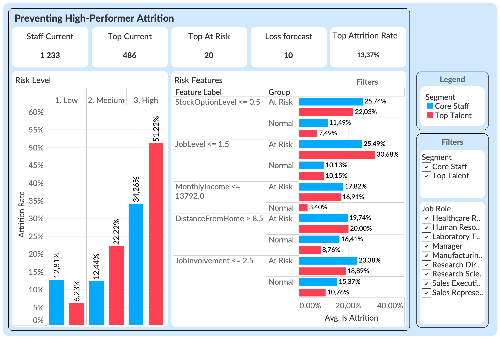

# HR Attrition Analytics: удержание ключевых сотрудников (Top Talent)

Аналитический проект на датасете **IBM HR Analytics**.

Задача: выяснить, из-за чего уходят ключевые сотрудники (`PerformanceRating = 4` или `JobLevel >= 3`), найти среди работающих тех, кто попадает в похожий профиль риска, и визуализировать это в Tableau.

## Дашборд



## Структура репозитория

```text
├── data/
│   ├── WA_Fn-UseC_-HR-Employee-Attrition.csv   # исходный датасет
│   ├── clean.parquet                           # очищенные данные
│   ├── avito_hr_datamart.csv                   # витрина со скорингом рисков
│   └── avito_hr_dynamic_drivers.csv            # витрина порогов и драйверов
├── notebooks/
│   ├── 01_data_cleaning.ipynb                  # чистка данных и проверка на аномалии
│   ├── 02_eda_insights.ipynb                   # корреляции Спирмена, Lift, графики плотности
│   └── 03_scoring_datamart.ipynb               # отбор фич (p < 0.05), дерево решений, экспорт
├── tableau/
│   └── dashboard.png                           # скриншот дашборда
└── README.md
```

## Этапы работы

1. **Очистка данных (`01_data_cleaning.ipynb`)**
   Проверил выгрузку на дубликаты, пропуски и логические ошибки (например, когда стаж в компании больше общего стажа или возраста). Удалил константные столбцы (`EmployeeCount`, `Over18`, `StandardHours`) и сохранил результат в `parquet`.

2. **Поиск факторов оттока (`02_eda_insights.ipynb`)**
   Разделил сотрудников на `Top Talent` (561 чел., отток 13.4%) и `Core Staff` (909 чел., отток 17.8%). Через корреляцию Спирмена, метрику `Lift` и графики плотности проверил, какие факторы сильнее влияют на уход топов по сравнению с остальным штатом.

3. **Скоринг и сборка витрин (`03_scoring_datamart.ipynb`)**
   Отфильтровал статистически значимые признаки (`p-value < 0.05`) и обучил на топах неглубокое дерево решений (`DecisionTreeClassifier`, `max_depth=3`). Это позволило без ручного подбора порогов рассчитать вероятность ухода (`risk_proba`), вытащить границы признаков и разбить людей на группы риска.

## Выводы

* В дерево решений вошли пять факторов: отсутствие опционов (`StockOptionLevel` — 33.7%), грейд (`JobLevel` — 32.5%), оклад (`MonthlyIncome` — 15.5%), расстояние до офиса (`DistanceFromHome` — 13.8%) и вовлеченность (`JobInvolvement` — 4.5%).
* На исторических данных отток среди топов растет с **6.2%** в группе `Low Risk` до **22.2%** в `Medium Risk` и **51.2%** в `High Risk`.
* В группу `High Risk` попали **20 действующих топов** (ожидаемый уход без вмешательства — около **10 человек**). Их список размечен в финальной витрине для дальнейшей работы HR (встречи 1-на-1, пересмотр окладов и опционов, перевод на гибрид).

## Стек

* **Python:** `pandas`, `numpy`, `scipy`, `scikit-learn`, `seaborn`, `matplotlib`
* **BI:** Tableau
